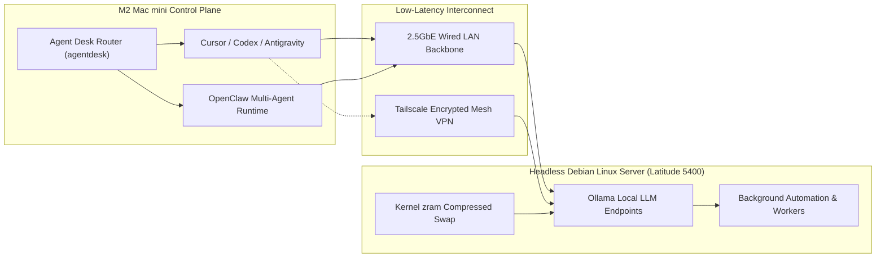

# Mike Mac Mesh — Multi-Node Local LLM & Multi-Device Mesh

> **Architecture:** Apple M2 Mac mini Workstation + Headless Debian Linux Server (`zram`-Tuned) + Local Ollama Inference + 2.5GbE LAN / Tailscale Mesh VPN + File-First Multi-Agent Context Architecture (`OpenClaw` / `Codex` / `Cursor`)  

## 1. Executive Summary & Problem Statement
Cloud-only LLM development workflows introduce recurring API cost spikes, data privacy constraints, and severe context drift across long-running multi-repository engineering sessions.

**Mike Mac Mesh** links all home computing devices into a unified, low-latency, privacy-first local AI mesh. It offloads routine inference, background automation, and local model evaluation to a dedicated headless **Debian Linux server** connected via **2.5GbE LAN** and **Tailscale mesh VPN** to an **M2 Mac mini** workstation, governed by a deterministic, file-first Markdown routing system (`Agent Desk`).

---

## 2. System Architecture & Infrastructure Topology



---

## 3. Key Engineering Decisions & Production Highlights

### Memory-Optimized Headless Linux Node (`Debian` + `zram`)
* Repurposed commodity x86_64 hardware (Dell Latitude 5400) into a headless Debian inference appliance, tuning kernel `zram` compressed swap parameters and systemd service limits to sustain quantized local LLM weights without OOM thrashing.

### Dual-Path Network Topology (`2.5GbE LAN` + `Tailscale Mesh VPN`)
* Configured sub-millisecond local routing over a **2.5GbE wired backbone** for high-throughput token streaming at the desk, with automatic failover to **Tailscale mesh VPN** for secure remote access from any location.

### File-First Context Engineering (`Agent Desk` + `AGENTS.md`)
* Designed a strict token-economy protocol (`~/Documents/Agent Desk/`) that routes coding agents (`OpenClaw`, `Codex`, `Cursor`) to minimal, task-scoped playbooks (`routes/*.md`) and repository-level `AGENTS.md` contracts—eliminating full-workspace context bloat.

---

## 4. Infrastructure Layout

```text
mike-mac-mesh/
├── ~/Documents/Agent Desk/
│   ├── START HERE.md           # Top-level Finder & CLI routing index
│   └── routes/
│       ├── project-work.md     # Repo checkout, runtime & verification rules
│       ├── efficient-agent-work.md # Token-efficiency & context-cap rules
│       ├── mac-and-files.md    # Safe filesystem inspection & organization
│       └── workflow-authoring.md # Repeatable script + markdown packaging
├── ~/.openclaw/                # Multi-agent task queues, policies & council state
└── ~/Projects/AGENTS.md        # Global engineering & token-economy contract
```

---

## 5. Verification & Operations

```bash
# 1. Inspect home-folder topology and active agent routes
agentdesk map
agentdesk route project

# 2. Verify Tailscale mesh connectivity & local Ollama endpoint health
tailscale status
curl -s http://<debian-node-ip>:11434/api/tags | jq .
```
